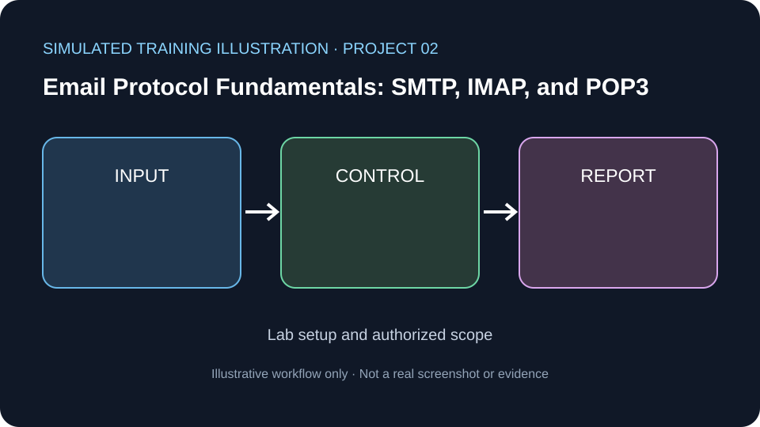
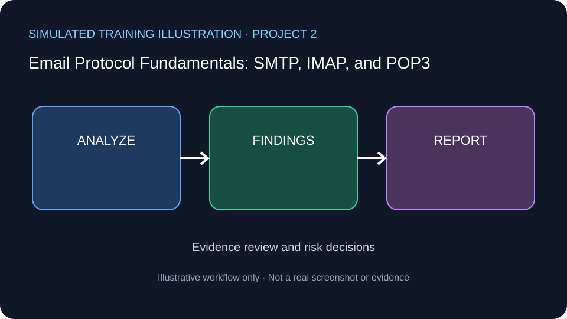
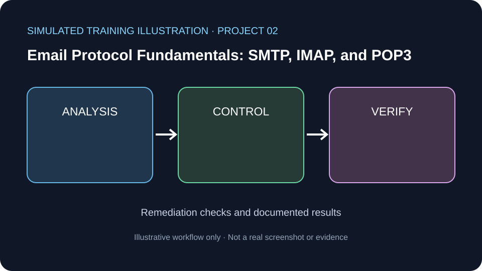

# Project 02: Email Protocol Fundamentals: SMTP, IMAP, and POP3

**Level:** Beginner  
**Track:** Email Security & Phishing Assessment

## Objective
Map the roles, ports, security properties, and trust boundaries of SMTP, IMAP, and POP3.

## Scope and authorization
Use only systems, domains, DNS zones, and mailboxes you own or have written permission to assess. This exercise is restricted to an isolated lab and synthetic data. Do not contact real users or external mail systems unless separately authorized.

## Prerequisites
Kali Linux; openssl; dig; local lab services; protocol reference notes.

## Lab setup
1. Create a dedicated isolated lab network and record its subnet, hostnames, and owner.
2. Use the fictional namespace `mail.lab.test` and reserved example domains; do not impersonate a real organization.
3. Create synthetic users and test mailboxes. Keep credentials disposable and local.
4. Snapshot the lab and store configuration backups before changing controls.

## Walkthrough
1. Create a protocol matrix
2. Distinguish message submission from relay and mailbox access
3. Inspect service banners only on lab hosts
4. Compare plaintext and TLS endpoints
5. Document secure configuration requirements.

## Example commands and tools
```bash
openssl s_client -connect mail.lab.test:587 -starttls smtp
openssl s_client -connect mail.lab.test:993
```

Run commands only against your lab. Adapt hostnames and ports to the documented lab configuration.

## Expected output
- A repeatable baseline or test record tied to the lab asset and timestamp.
- Sanitized evidence showing the relevant protocol, DNS, message, gateway, or policy behavior.
- A clear pass/fail/needs-review result for each test case.

## Findings and risk assessment
Record the observed condition, affected asset, evidence reference, likelihood, impact, and business consequence. Separate confirmed weaknesses from assumptions. Prioritize spoofing, unauthorized relay, weak transport protection, missing authentication alignment, and visibility gaps according to the specific scope.

## Framework mapping
Map applicable observations to NIST CSF 2.0 (Protect/Detect/Respond), CIS Controls v8 (secure configuration, access control, audit logging), and MITRE ATT&CK email/identity techniques only where evidence supports the mapping. Avoid assigning a technique solely because a tool was used.

## Remediation
Apply least-privilege sender authorization, strong authentication, TLS, SPF/DKIM/DMARC alignment, gateway policy, monitoring, and documented exception handling as appropriate. Roll out policy changes in stages and validate legitimate business mail flows.

## Validation criteria
- Re-run the same safe test cases after remediation.
- Confirm expected allowed and blocked outcomes using synthetic identities.
- Verify logs, alert routing, and evidence retention.
- Record residual risk, owner, and retest date.

## Evidence and reporting checklist
- [ ] Written authorization and scope
- [ ] Lab topology and test date
- [ ] Sanitized configuration and test outputs
- [ ] Finding severity, rationale, and affected asset
- [ ] Remediation owner and validation evidence
- [ ] Executive summary and limitations

## Training illustrations






## Deliverables
A concise assessment worksheet, sanitized evidence bundle, prioritized findings, and remediation/retest notes.
