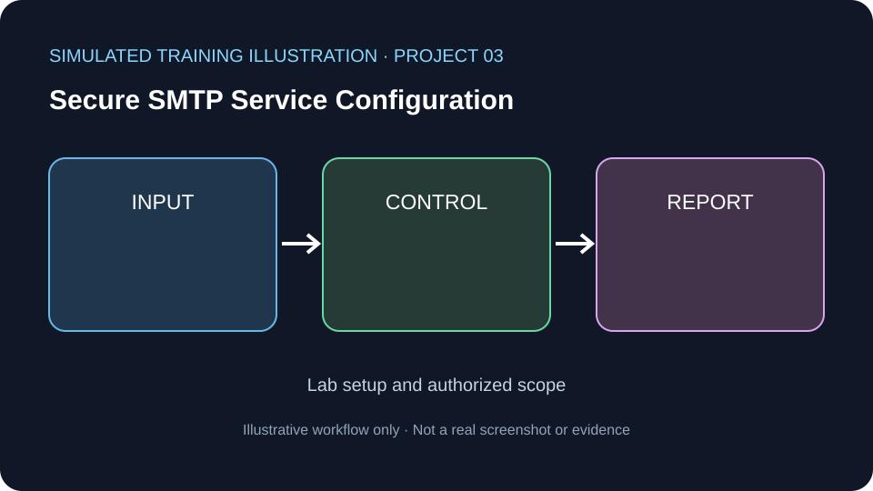
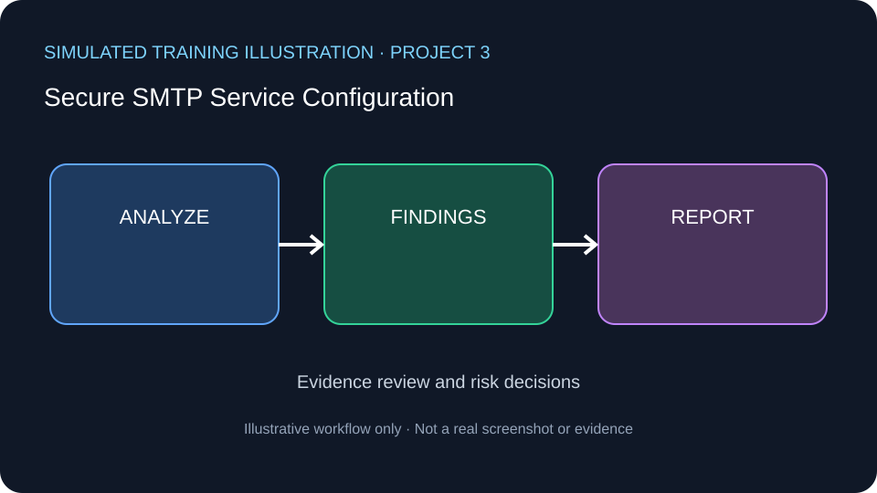
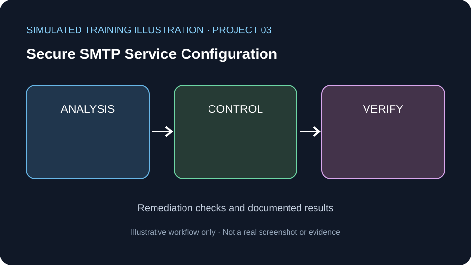

# Project 03: Secure SMTP Service Configuration

**Level:** Beginner  
**Track:** Email Security & Phishing Assessment

## Objective
Harden a lab SMTP service against open relay, weak transport, and excessive exposure.

## Scope and authorization
Use only isolated lab systems, domains, and mailboxes you own or are explicitly authorized to assess. Use synthetic identities and harmless messages. Do not target real users, collect credentials, or deliver test mail to public recipients.

## Prerequisites
Kali Linux, a dedicated lab network, a local mail sink or test service, and sanitized synthetic samples as applicable.

## Lab setup
1. Create an isolated lab and record hostnames, ports, and owner.
2. Use fictional `.test` domains and disposable synthetic accounts.
3. Snapshot services and preserve configuration backups.
4. Confirm outbound delivery to public mail systems is blocked.

## Walkthrough
1. Review listeners
2. Require authenticated submission
3. Restrict relay destinations
4. Enable TLS
5. Test allowed/denied synthetic recipients
6. Save before/after configs.

## Example commands and tools
```bash
openssl s_client -starttls smtp -connect mail.lab.test:587
```

## Expected output
- A repeatable configuration or analysis record.
- Sanitized evidence and a clear pass/fail/needs-review result.
- A prioritized list of control gaps and remediation actions.

## Findings and risk assessment
Record affected asset, observed condition, evidence, likelihood, impact, confidence, and business consequence. Separate confirmed weaknesses from assumptions and document false positives.

## Framework mapping
Consider NIST CSF 2.0 Protect/Detect/Respond and CIS Controls v8 secure configuration, access control, and audit logging. Use MITRE ATT&CK mappings only when a specific observed behavior supports them.

## Remediation
Apply least privilege, secure transport, authenticated mail, SPF/DKIM/DMARC alignment, gateway controls, monitoring, and documented change control as applicable.

## Validation criteria
- Re-run the same safe test cases after remediation.
- Confirm expected allowed/blocked behavior.
- Verify logs and alert routing.
- Record residual risk and retest date.

## Evidence and reporting checklist
- [ ] Authorization and scope
- [ ] Lab topology and test date
- [ ] Sanitized configuration and outputs
- [ ] Finding severity and rationale
- [ ] Remediation owner and validation evidence
- [ ] Executive summary and limitations

## Training illustrations






## Deliverables
Assessment worksheet, sanitized evidence bundle, prioritized findings, and remediation/retest notes.
