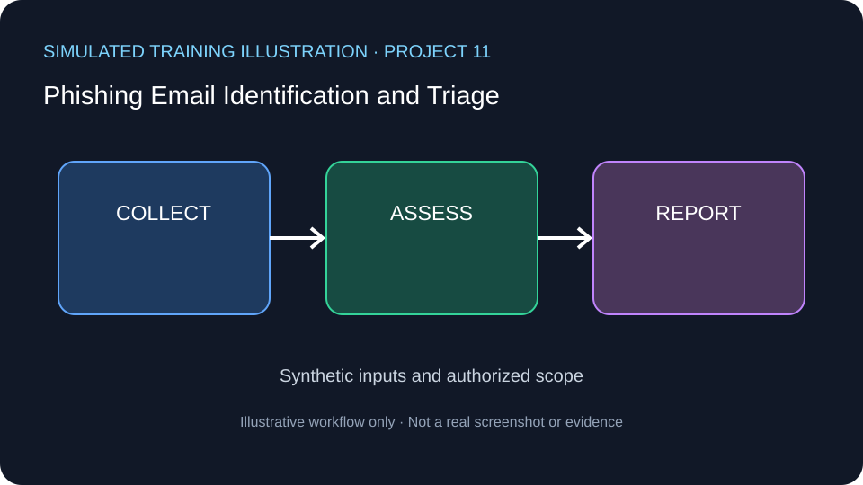
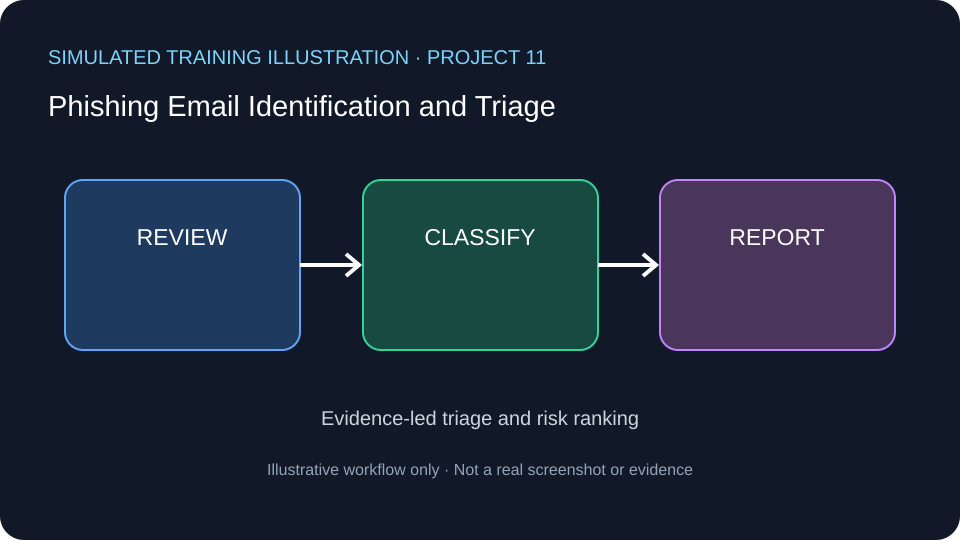

# Project 11: Phishing Email Identification and Triage

**Level:** Beginner  
**Track:** Email Security & Phishing Assessment

## Objective
Triage synthetic phishing messages using sender, header, URL, language, and context signals.

## Scope and authorization
Use only isolated lab systems and synthetic identities. Awareness simulations require written approval, participant safeguards, a debrief plan, and an explicit no-credential-collection design. No real-world targeting, credential capture, or delivery to public recipients.

## Prerequisites
Sanitized .eml samples; text editor; URL parser; isolated analysis VM.

## Lab setup
1. Build a dedicated isolated environment and snapshot it.
2. Use fictional identities and reserved `.test` domains.
3. Route all generated email to a local SMTP sink.
4. Store sanitized evidence and keep personal data out of exports.

## Walkthrough
1. Inspect sender and reply-to mismatch
2. Review Authentication-Results
3. Extract URLs without opening them
4. Compare domain age only through approved passive sources
5. Classify confidence and preserve original evidence.

## Example commands and tools
```bash
python3 - <<'PY'
from email import policy
from email.parser import BytesParser
m=BytesParser(policy=policy.default).parse(open('sample.eml','rb'))
print('From:',m.get('From')); print('Reply-To:',m.get('Reply-To')); print('Subject:',m.get('Subject'))
PY
```

Commands are illustrative and must be limited to the lab assets in scope.

## Expected output
- A reproducible triage or simulation record.
- Sanitized indicators and supporting evidence.
- A disposition, confidence level, and escalation decision.

## Findings and risk assessment
Document the affected control, evidence, business impact, likelihood, confidence, and false-positive considerations. Distinguish suspicious indicators from proof of compromise.

## Framework mapping
Consider NIST CSF 2.0 (Protect, Detect, Respond), CIS Controls v8 (email/web browser protections, access control, audit logs), and relevant MITRE ATT&CK phishing or identity techniques only when the observed behavior supports the mapping.

## Remediation
Tune authentication alignment, gateway protections, user reporting, mailbox auditing, identity controls, and response workflows. For awareness work, prioritize education and safe reporting over punitive individual scoring.

## Validation criteria
- Repeat tests with the same synthetic corpus.
- Confirm alerts and routing to the intended analysts.
- Confirm no real credentials or sensitive personal data were collected.
- Document residual risk and a retest date.

## Evidence and reporting checklist
- [ ] Authorization, scope, and participant safeguards
- [ ] Synthetic sample inventory and hashes
- [ ] Sanitized logs and message headers
- [ ] Finding rationale and confidence
- [ ] Remediation owner and retest evidence
- [ ] Retention/deletion confirmation

## Training illustrations





## Deliverables
A sanitized triage worksheet or awareness assessment, findings register, and improvement plan.
