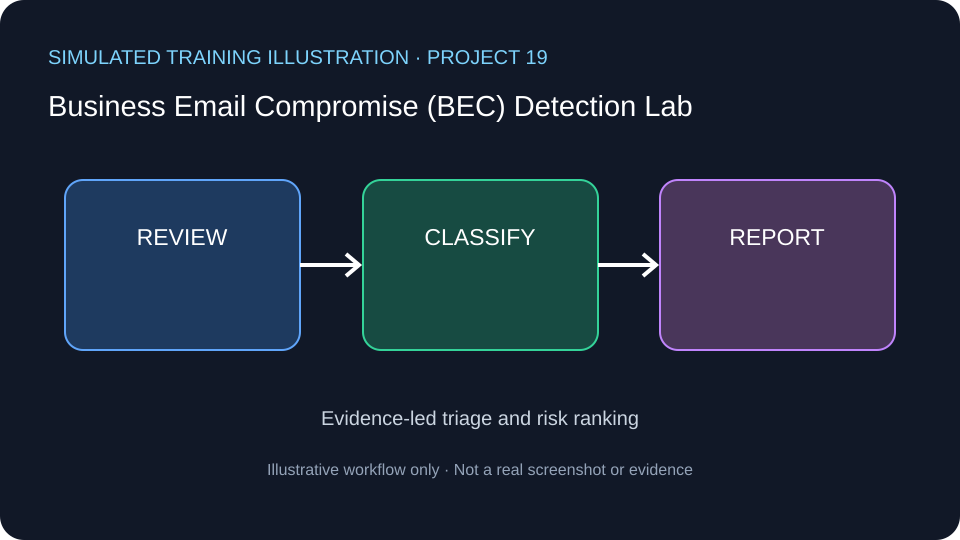
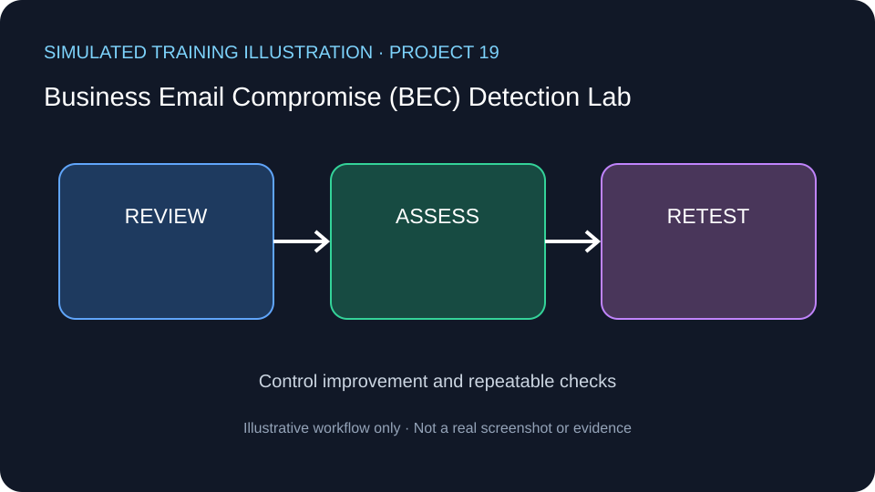

# Project 19: Business Email Compromise (BEC) Detection Lab

**Level:** Intermediate  
**Track:** Email Security & Phishing Assessment

## Objective
Detect synthetic BEC patterns such as payment-change requests and executive impersonation.

## Scope and authorization
Use only isolated lab systems and synthetic identities. Awareness simulations require written approval, participant safeguards, a debrief plan, and an explicit no-credential-collection design. No real-world targeting, credential capture, or delivery to public recipients.

## Prerequisites
Synthetic mail corpus; SIEM or spreadsheet; mailbox audit events.

## Lab setup
1. Build a dedicated isolated environment and snapshot it.
2. Use fictional identities and reserved `.test` domains.
3. Route all generated email to a local SMTP sink.
4. Store sanitized evidence and keep personal data out of exports.

## Walkthrough
1. Create harmless sample messages
2. Label sender impersonation, urgency, payment-change, and reply-chain anomalies
3. Correlate sign-in and mailbox events
4. Define escalation checks
5. Avoid contacting any real financial institution.

## Example commands and tools
```bash
# Search sanitized lab events for payment-change language
 grep -RniE 'new bank|wire change|urgent payment' ./synthetic-mail/
```

Commands are illustrative and must be limited to the lab assets in scope.

## Expected output
- A reproducible triage or simulation record.
- Sanitized indicators and supporting evidence.
- A disposition, confidence level, and escalation decision.

## Findings and risk assessment
Document the affected control, evidence, business impact, likelihood, confidence, and false-positive considerations. Distinguish suspicious indicators from proof of compromise.

## Framework mapping
Consider NIST CSF 2.0 (Protect, Detect, Respond), CIS Controls v8 (email/web browser protections, access control, audit logs), and relevant MITRE ATT&CK phishing or identity techniques only when the observed behavior supports the mapping.

## Remediation
Tune authentication alignment, gateway protections, user reporting, mailbox auditing, identity controls, and response workflows. For awareness work, prioritize education and safe reporting over punitive individual scoring.

## Validation criteria
- Repeat tests with the same synthetic corpus.
- Confirm alerts and routing to the intended analysts.
- Confirm no real credentials or sensitive personal data were collected.
- Document residual risk and a retest date.

## Evidence and reporting checklist
- [ ] Authorization, scope, and participant safeguards
- [ ] Synthetic sample inventory and hashes
- [ ] Sanitized logs and message headers
- [ ] Finding rationale and confidence
- [ ] Remediation owner and retest evidence
- [ ] Retention/deletion confirmation

## Training illustrations






## Deliverables
A sanitized triage worksheet or awareness assessment, findings register, and improvement plan.
