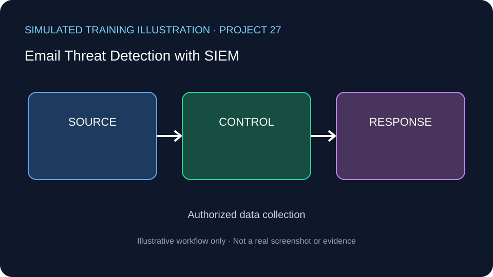
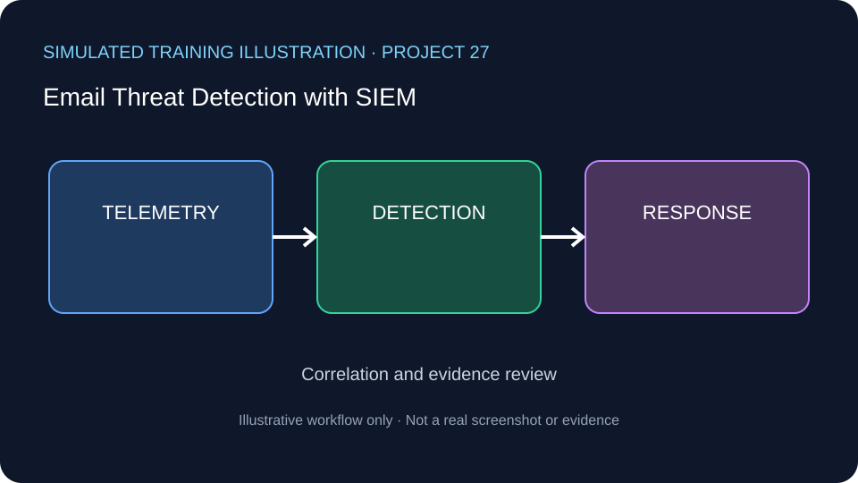
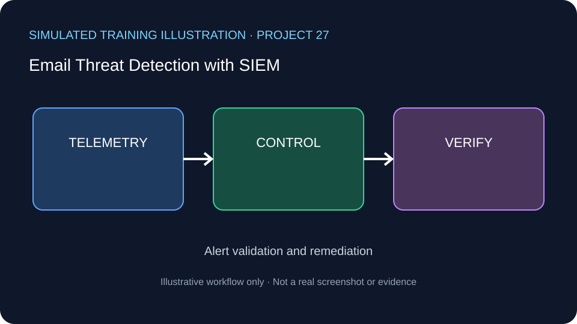

# Project 27: Email Threat Detection with SIEM

**Level:** Intermediate  
**Track:** Email Security & Phishing Assessment

## Objective
Create detections for suspicious email and identity events using synthetic telemetry.

## Scope and authorization
Assess only explicitly authorized tenants, mail gateways, domains, and synthetic mailboxes. Prefer read-only review and isolated test cases. Do not send phishing content to real users or collect credentials, tokens, or personal data.

## Prerequisites
SIEM lab; sample mail gateway logs; identity audit logs; synthetic data.

## Lab setup
1. Identify the authorized tenant or isolated lab and document its owner.
2. Export baseline settings and preserve rollback copies.
3. Use synthetic accounts and sanitized test events.
4. Confirm logs are available and time-synchronized.

## Walkthrough
1. Normalize sender, recipient, verdict, URL, attachment hash, and mailbox event fields
2. Write detection logic
3. Test benign and suspicious synthetic cases
4. Tune thresholds
5. Document alert triage.

## Example commands and tools
```bash
# Example normalized event search (adapt to your SIEM)
index=email_lab event_type=phish_verdict | stats count by sender_domain, verdict
```

Use vendor-supported read-only queries where possible; adapt syntax to your tenant and permissions.

## Expected output
- A control inventory and repeatable test matrix.
- Sanitized logs or configuration evidence.
- Detection results, exceptions, and analyst disposition.

## Findings and risk assessment
For each finding record condition, evidence, affected service, likelihood, impact, confidence, and compensating controls. Note false positives and dependencies such as mail-flow connectors or third-party senders.

## Framework mapping
Map applicable controls to NIST CSF 2.0, CIS Controls v8, and MITRE ATT&CK only where the evidence supports the mapping. Consider identity governance, secure configuration, audit logging, and incident response.

## Remediation
Apply least privilege, narrow exceptions, strong authentication, mail authentication alignment, alerting, and change control. Coordinate changes with mail owners and validate legitimate business workflows.

## Validation criteria
- Re-run test cases against the updated configuration.
- Confirm expected mail routing, block, quarantine, and alert outcomes.
- Verify audit coverage and incident ownership.
- Record residual risk and retest date.

## Evidence and reporting checklist
- [ ] Authorization and scope
- [ ] Baseline configuration snapshot
- [ ] Sanitized test cases and audit events
- [ ] Finding rationale and severity
- [ ] Remediation and rollback plan
- [ ] Retest evidence and residual risk

## Training illustrations






## Deliverables
A configuration assessment, safe test matrix, findings register, and remediation/retest report.
