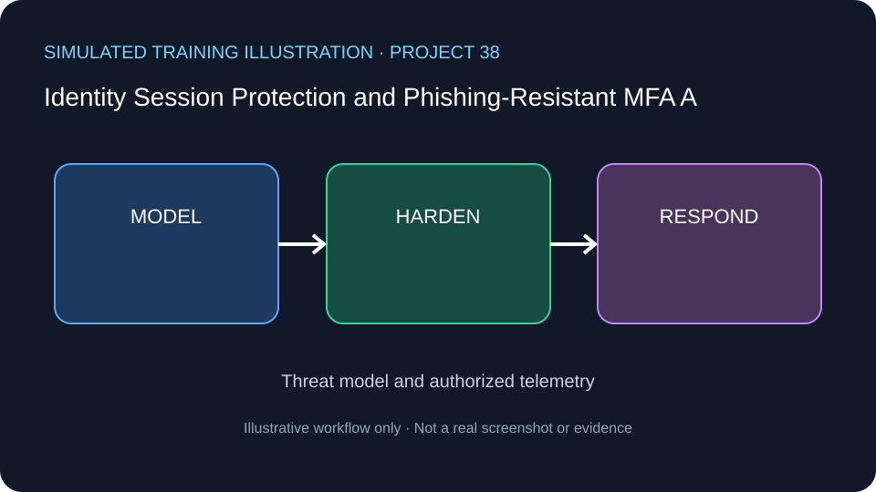
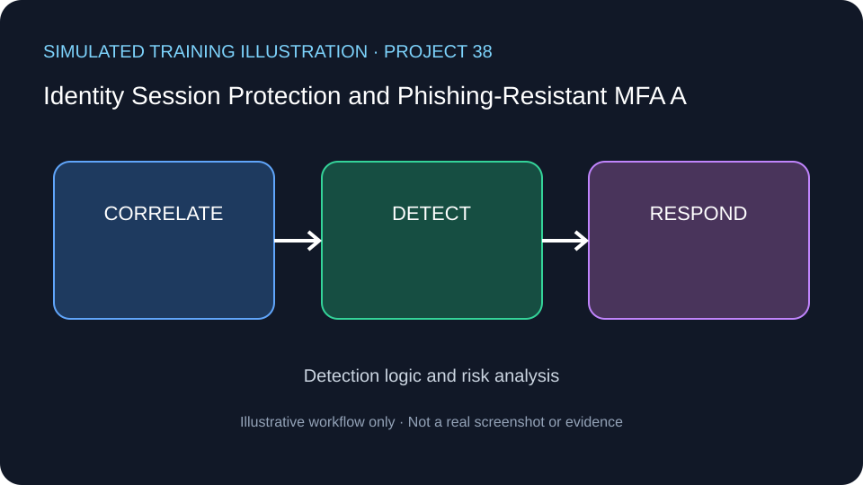
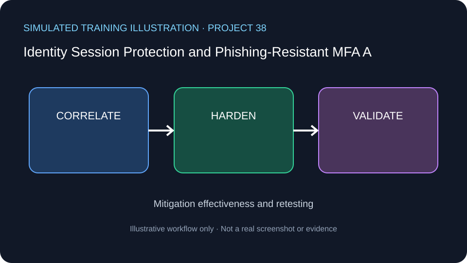

# Project 38: Identity Session Protection and Phishing-Resistant MFA Assessment

**Level:** Advanced  
**Track:** Email Security & Phishing Assessment

## Objective
Assess controls that reduce credential replay and session compromise risk.

## Scope and authorization
This project is defensive and lab-only. Use synthetic identities, fabricated events, and explicitly authorized test tenants. Evilginx content is limited to threat modeling, telemetry, detection, and mitigation. Do not deploy interception infrastructure, harvest credentials or session tokens, bypass MFA, or target real users or services.

## Prerequisites
Test identity tenant; FIDO2/passkey security keys; conditional access exports; synthetic users.

## Lab setup
1. Establish a dedicated lab tenant or offline dataset and document authorization.
2. Use synthetic identities and fabricated indicators only.
3. Ensure no test traffic is routed to public targets.
4. Snapshot configurations and preserve sanitized baseline logs.

## Walkthrough
1. Inventory MFA methods
2. Prioritize phishing-resistant authenticators
3. Review session lifetime and reauthentication
4. Evaluate device compliance and risk policies
5. Test recovery paths
6. Document exclusions and break-glass protections.

## Example commands and tools
```bash
# Review authentication methods and conditional-access policies in an authorized test tenant
```

## Expected output
- A threat model or defensive detection specification.
- Synthetic test events and repeatable alert results.
- A documented mitigation and validation plan.

## Findings and risk assessment
Describe the threat path, affected identity controls, telemetry confidence, potential business impact, and gaps. Do not treat a single anomalous sign-in as conclusive compromise without corroborating evidence.

## Framework mapping
Consider MITRE ATT&CK phishing and valid-account techniques for threat modeling, NIST CSF 2.0 Protect/Detect/Respond, and CIS Controls v8 access control and audit logging. Map only evidence-supported behaviors.

## Remediation
Prioritize phishing-resistant MFA, conditional access, device trust, risk-based sign-in controls, session protection, least privilege, user reporting, and identity telemetry. Ensure emergency access accounts are protected and monitored.

## Validation criteria
- Test detections with positive and benign synthetic fixtures.
- Verify alerts include actionable context and response ownership.
- Confirm security controls work without disrupting approved access.
- Record residual risk and retest date.

## Evidence and reporting checklist
- [ ] Written authorization and defensive scope
- [ ] Threat model and data-flow diagram
- [ ] Sanitized identity events and detection tests
- [ ] False-positive and coverage analysis
- [ ] Mitigation owner and validation results
- [ ] Explicit confirmation no credentials or tokens were collected

## Training illustrations






## Deliverables
A defensive threat model, detection rules or test cases, prioritized control recommendations, and retest evidence.
