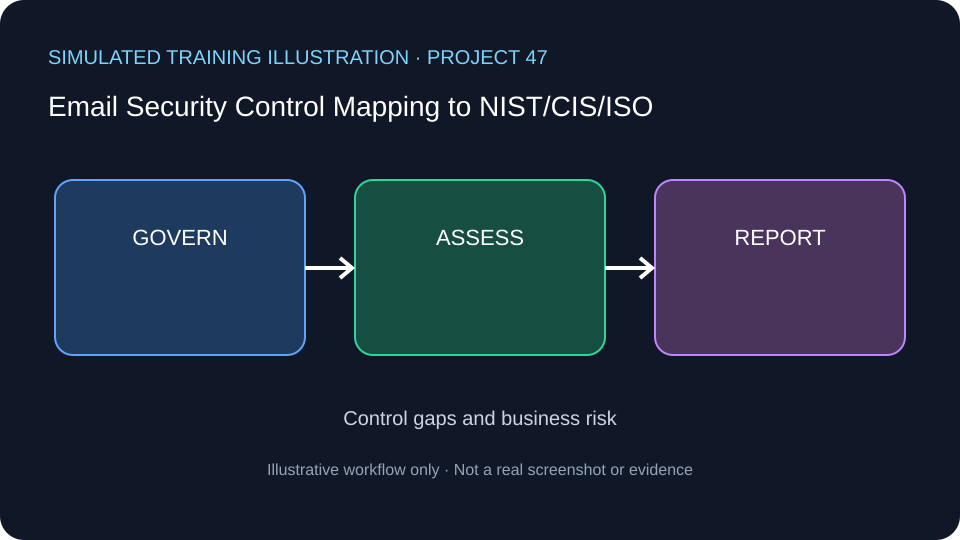
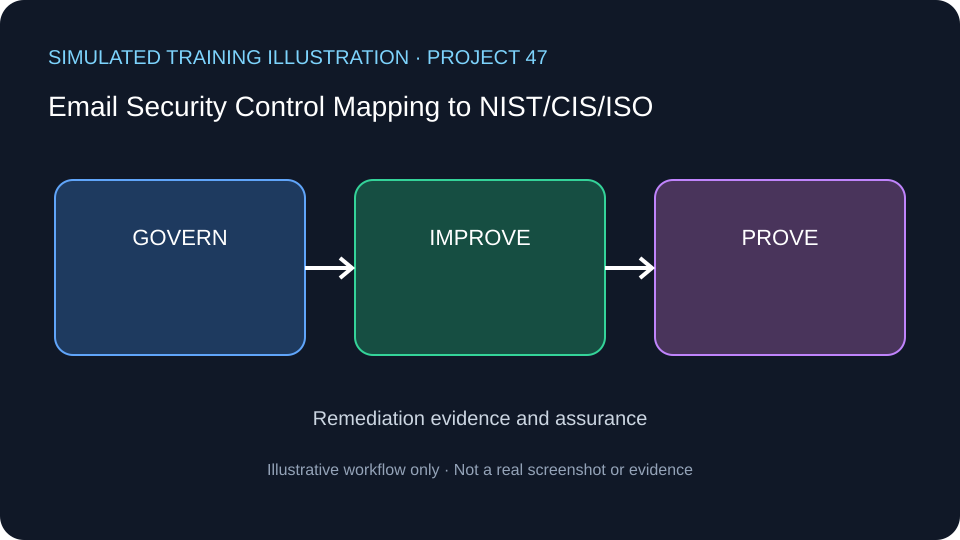

# Project 47: Email Security Control Mapping to NIST/CIS/ISO

**Level:** Advanced  
**Track:** Email Security & Phishing Assessment

## Objective
Map email security controls and evidence to recognized security frameworks.

## Scope and authorization
Use documented authorization and approved evidence sources. Simulated scenarios must use synthetic identities, sanitized records, and isolated test environments. No real-world phishing, credential collection, session interception, or unauthorized testing.

## Prerequisites
NIST CSF 2.0; CIS Controls v8; ISO/IEC 27001:2022; control inventory; evidence register.

## Lab setup
1. Define business owner, systems in scope, objectives, and exclusions.
2. Gather approved architecture and configuration evidence.
3. Use synthetic events and a dedicated test tenant wherever practical.
4. Establish evidence handling, retention, and change-control procedures.

## Walkthrough
1. Map controls to policy and technical implementation
2. Identify evidence owner and frequency
3. Distinguish design from operating effectiveness
4. Record gaps and compensating controls
5. Build an audit-ready crosswalk.

## Example commands and tools
```bash
# Create a structured control register in CSV or spreadsheet
```

## Expected output
- An architecture, assessment, playbook, or control-mapping artifact.
- Evidence-backed findings with owners and business impact.
- A prioritized improvement roadmap and validation plan.

## Findings and risk assessment
Assess likelihood, impact, exposure, control effectiveness, dependencies, and residual risk. Identify assumptions and evidence limitations. Prioritize systemic weaknesses affecting multiple domains, mailboxes, or business processes.

## Framework mapping
Use NIST CSF 2.0, CIS Controls v8, and ISO/IEC 27001:2022 as appropriate. For threat scenarios, reference MITRE ATT&CK only when a technique is relevant to the modeled behavior. Record exact control identifiers in the final crosswalk.

## Remediation
Assign accountable owners, target dates, dependencies, and measurable outcomes. Prefer defense in depth: authenticated mail, secure transport, hardened gateways, phishing-resistant identity controls, mailbox auditing, user reporting, and tested incident response.

## Validation criteria
- Confirm each control has an owner and evidence source.
- Repeat safe test cases or review operating evidence after remediation.
- Verify alert, escalation, and recovery workflows.
- Record exceptions, residual risk, and next review date.

## Evidence and reporting checklist
- [ ] Authorization, scope, and exclusions
- [ ] Architecture and control inventory
- [ ] Sanitized evidence and test results
- [ ] Risk ratings with rationale
- [ ] Remediation owners and due dates
- [ ] Retest and residual-risk approval

## Training illustrations






## Deliverables
An executive summary, technical assessment artifacts, prioritized risk register, and remediation validation plan.
